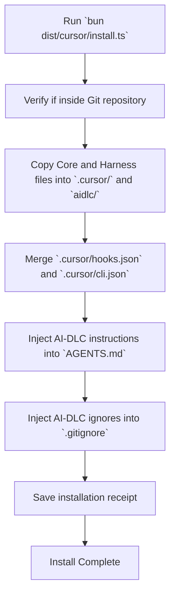
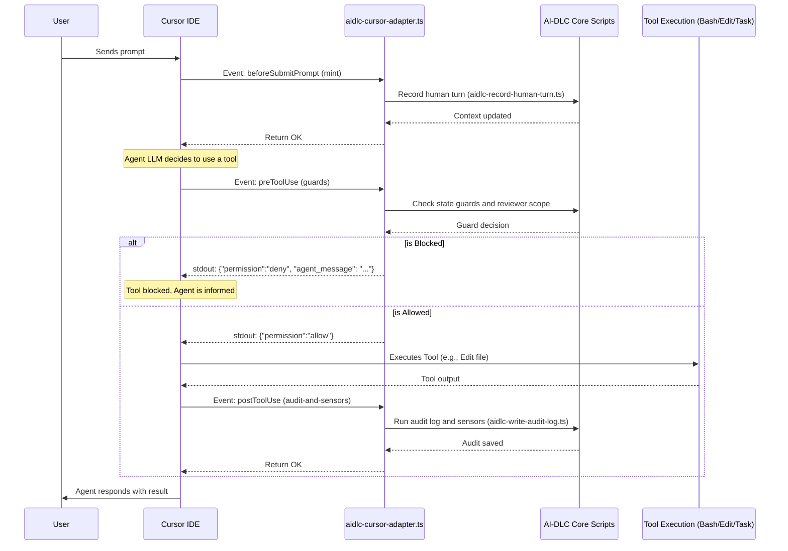

# AI-DLC Cursor Harness Analysis

This document details how the AI-DLC framework is injected into a Cursor IDE workspace and how it orchestrates actions step-by-step during runtime.

## 1. Installation Process

The installation into a Cursor workspace is driven by the `install.ts` script (`harness/cursor/install.ts`). This script is non-destructive and establishes the necessary configuration files and hooks for Cursor to integrate with AI-DLC.

### How it works step-by-step:

1. **Validate Environment**: The script first verifies the target directory and checks if it's within a valid Git repository, which is crucial because Cursor might skip project hooks in non-Git folders.
2. **Copy Core and Harness Files**: The script copies the pre-built, harness-neutral core files and the Cursor-specific files from the distribution (`dist/.cursor/` and `dist/aidlc/`) into the target workspace's `.cursor/` and `aidlc/` directories.
3. **Handle Managed Content**: It compares the contents to be installed against a receipt of previously installed files (using SHA-256 hashes). It won't blindly overwrite user-modified files unless they are explicitly runtime-owned.
4. **Merge JSON Configurations**:
    - `hooks.json` (Cursor's event triggers) and `cli.json` (Cursor's shell permissions) are merged with any existing configurations the project might have.
5. **Inject into Root Files**:
    - **`AGENTS.md`**: It appends a managed block of ambient instructions. Cursor auto-reads this file for context.
    - **`.gitignore`**: It appends rules to ignore certain AI-DLC internal files (like `aidlc/spaces/default/active`).
6. **Refresh Plugin Routing**: If there are active AI-DLC plugins, it updates the runtime routing mechanisms.
7. **Write Install Receipt**: Finally, it generates an installation receipt (`.cursor/aidlc-common/receipt.json`) to track managed files for future upgrades.

### Installation Flow Diagram

## 2. Runtime Execution Flow (When an Agent Performs an Action)

When the user interacts with the Cursor agent, AI-DLC intercepts Cursor's built-in hooks. The primary mechanism for this is defined in `.cursor/hooks.json`, which points directly to `.cursor/hooks/aidlc-cursor-adapter.ts`. This adapter bridges Cursor's camelCase hook events to AI-DLC's core engine logic.

### Key Hook Injections:

*   **`sessionStart`** & **`sessionEnd`**: Track when a conversation begins or ends.
*   **`beforeSubmitPrompt`**: Fires before a user prompt is sent to the LLM. It logs the human turn and sets up session contexts.
*   **`preToolUse`**: A critical security and state-transition guard. It fires *before* the agent executes a tool (like `Bash`, `Edit`, `Task`).
*   **`postToolUse`**: Fires *after* a tool has executed, handling auditing, logging, and state compilation.

### Step-by-Step Runtime Flow (Example: Agent Using a Tool)

1.  **User Prompts the Agent**: The user types a message in Cursor Chat.
2.  **`beforeSubmitPrompt` Hook**:
    *   Cursor calls `aidlc-cursor-adapter.ts mint`.
    *   The adapter registers the chat session, ensures it's not a "background" automated task, and records the user's turn in the AI-DLC state.
3.  **Agent Plans an Action**: The LLM decides it needs to run a bash script or edit a file, attempting to invoke a tool.
4.  **`preToolUse` Hook**:
    *   Cursor calls `aidlc-cursor-adapter.ts guards`.
    *   **Security Check**: The adapter checks if the intended action violates AI-DLC rules. For example, if a delegated subagent tries to spawn another subagent (`Task`), or run arbitrary `Bash` commands, it is blocked.
    *   **Review Freeze / Guardrails**: It checks if the current stage allows this tool use based on the core state transition rules (`aidlc-state-transition-guard.ts` and `aidlc-plan-approval-guard.ts`).
    *   **Allow/Deny**: If blocked, it writes a `deny` permission JSON to `stdout` with an error message the agent will see. If permitted, it writes an `allow` JSON, and Cursor executes the tool.
5.  **Tool Execution**: Cursor executes the tool (e.g., modifying a file).
6.  **`postToolUse` Hook**:
    *   Cursor calls `aidlc-cursor-adapter.ts audit-and-sensors`.
    *   If a file was modified (`Write` or `Edit`), the adapter triggers AI-DLC's audit log and runs project sensors to detect structural changes.
    *   If a subagent (`Task`) finished, it clears the spawn lock and logs the subagent completion.
7.  **Agent Response**: The agent receives the tool output and replies to the user.

### Runtime Hook Interception Diagram

## Summary of Configuration Integration

1.  **Skills/Commands**: AI-DLC drops native Cursor Markdown skill files directly into `.cursor/skills/` (e.g., `aidlc-status/SKILL.md`). The orchestrator skill is located at `.cursor/skills/aidlc/SKILL.md`.
2.  **Rules (.mdc)**: AI-DLC injects `*.mdc` files into `.cursor/rules/`. Cursor parses the frontmatter to inject phase-specific guidelines natively during chat.
3.  **CLI Permissions**: `.cursor/cli.json` specifically whitelists AI-DLC scripts so the user isn't prompted by Cursor for permission every time AI-DLC attempts to run its own engine logic (like `bun .cursor/tools/aidlc.ts engine *`).
